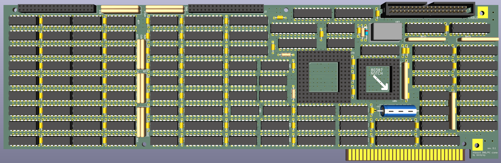
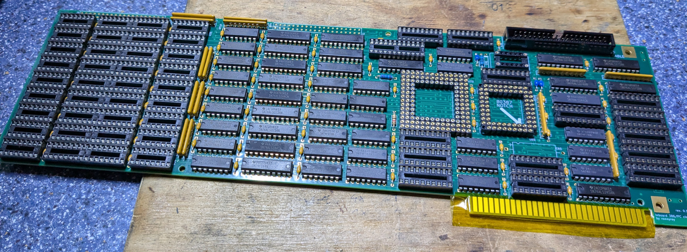
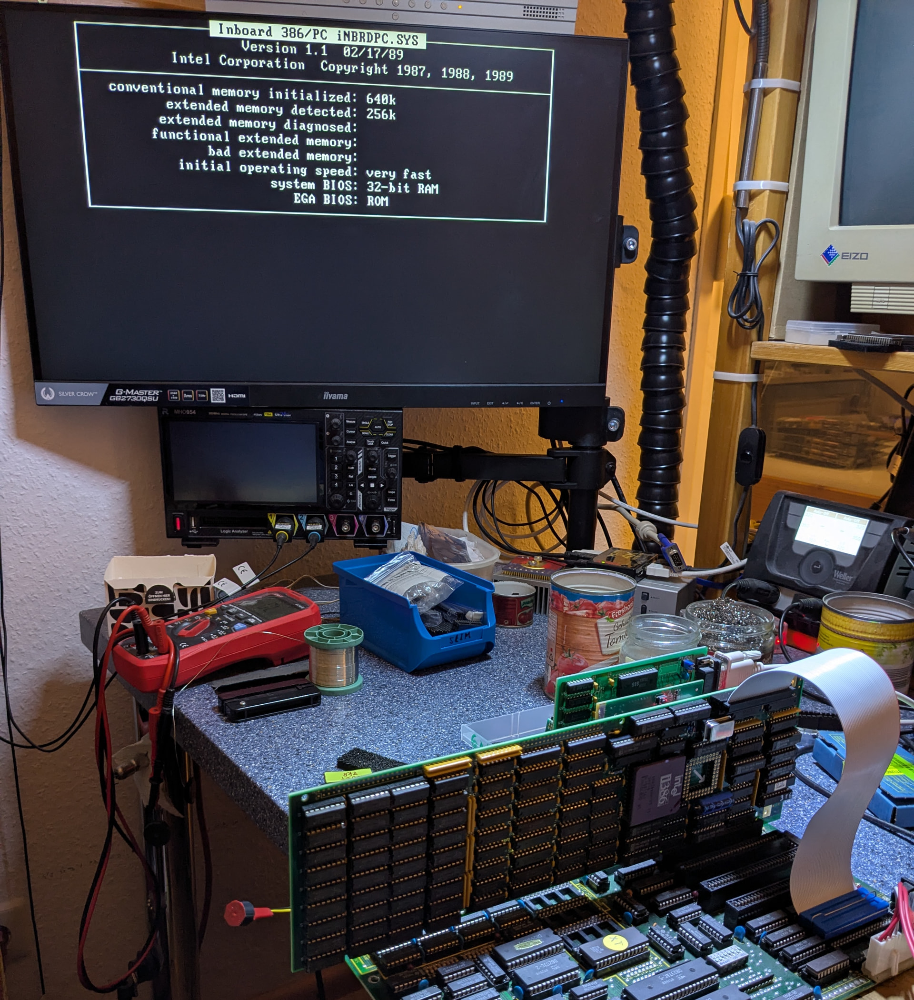

# Intel Inboard 386/PC Clone
https://forum.vcfed.org/index.php?threads/inboard386-pc-clone.1257894/
https://forum.theretroweb.com/t/intel-inboard-386-pc-accelerator-clone/44

  
  
This is a complete reverse engineered reproduction of [Intel Inboard 386/PC Accelerator Card](https://theretroweb.com/expansioncards/s/intel-inboard-386-pc).  
It's based on a damaged card that i obtained a while ago and managed to fix but decided to sacrifice for a reproduction.  
The Inboard 386/PC is an upgrade card from Intel for the IBM PC/XT and clones that upgraded the 8088 CPU to a 16MHz 386DX and up to 5MB of system memory.  
The card only uses standard 74 series logic chips along with some PALs/PROMs that were luckily not secured and were successfully dumped.  
The PCB is a 6 layer design with 4 signal layers. To aid with reverse engineering it i ended up choosing the destructive route and sanded the entire PCB down to the inner layers.  
By now the PCB design has been completed while the schematic still needs cleanup and further reverse engineering of the programmable logic to completely understand.  

The first revision of the board has been tested and confirmed to be working.  
  
Dumps of the PAL Chips and CUPL equations for the replacement Atmel PLD chips are in /logic.  
A memory expansion board prototype can be found under /mem.  
A 3D model of the bracket is at /bracket.  

The original board never intended for more than 5MB of ram to be used but can be modified with updated Logic equations in U71 to theoretically use up to 16MB.  
However the Inboard maps the portion of memory used for ROM caching at 0x580000-5FFFFF which is expected by INBRDPS.SYS.  
Currently that limits >5MB of memory to not use caching but could probably be solved with a modified INBRDPS.SYS.  

This current board design is a 1:1 copy of the original PCB, excluding some small details.  
A more compact version utilising SIMM memory and CPLDs is currently in work.  

# Assembly Guide:
You need the PCB for the inboard as well as the PROM adapter.  
A list of all required other components is located at /inboard386/parts_list.xlsx  
An html BOM is at /inboard386/bom/ibom.html  
The ideal assembly order is to place the small decoupling caps and resistors first, then place the chips and finish with the sockets, headers and large capacitor.  
For bending the capacitors/resistors one of these guides is very useful https://www.thingiverse.com/thing:168412  
